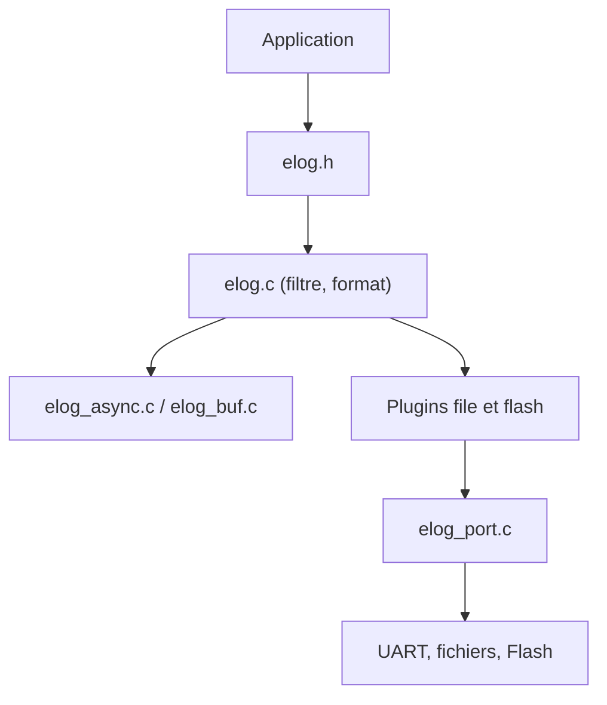

# armink/EasyLogger

> Bibliothèque de journalisation C/C++ ultra légère pour systèmes embarqués et IoT.

## Le problème
Les bibliothèques de log connues (log4c, zlog) sont trop lourdes pour des appareils à ROM et RAM comptées.

## Ce que ça fait vraiment
Elle occupe moins de 1,6 Ko de ROM et 0,3 Ko de RAM. Elle filtre par tag, niveau et mot-clé, formate niveau, heure, thread et fichier, sort en synchrone, asynchrone ou tamponné, et propose RAW et hexdump. Des plugins ajoutent le stockage en Flash et en fichiers avec rotation. Elle s'adapte à RT-Thread, FreeRTOS, Linux, Windows, Nuttx ou au bare-metal.

## Comment c'est branché


## Essayer
```bash
# Aucune commande dans le README (en chinois) : lire docs/zh/port/kernel.md
# puis adapter elog_port.c ; démo dans demo/os/rt-thread/stm32f10x/.
```

## Coût et pièges
Gratuit. Il faut un portage par cible (elog_port.c) ; la configuration est un singleton global. Le README est en chinois.

## Ce que ce n'est pas
Ce n'est pas un outil de supervision ni de collecte de logs : c'est une bibliothèque C embarquée. Une seule configuration par programme.

## Alternatives
log4c et zlog, cités comme plus riches mais moins simples à prendre en main.

## Pour toi
À ignorer : utile en firmware embarqué, hors du périmètre d'un travail data, IA ou MLOps.

