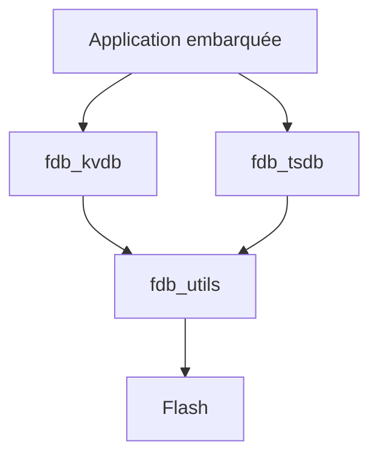

# armink/FlashDB

> Embedded key-value and time-series database for microcontroller Flash memory.

## The problem
Store settings and measurements in the Flash of a connected device without a file system, without wearing it out prematurely or losing data on power loss.

## What it actually does
FlashDB offers two modes: a key-value database (strings and blobs, incremental upgrade after a firmware update) and a timestamped time-series database. It handles wear leveling, power-failure protection and multiple partitions or instances. The README claims near-zero RAM and gives measurements: about 4 ms per insert on a W25Q64 NOR flash.

## How it is wired
Simplified diagram based on the sheet, no diagram provided.



## Trying it
```bash
msh />tsl bench
```
This benchmark command comes from the README; the getting-started guide is in the online documentation.

## Cost and gotchas
Free, but you have to port it to your chip following the porting document. 188 open issues.

## What it is not
It is not an SQL database or a tool for servers or notebooks: it targets embedded firmware. No data or AI use.

## Alternatives
No alternative is named in the README.

## For you
Ignore: excellent for embedded, but unrelated to a data / AI / MLOps profile, unless you have an IoT project.
