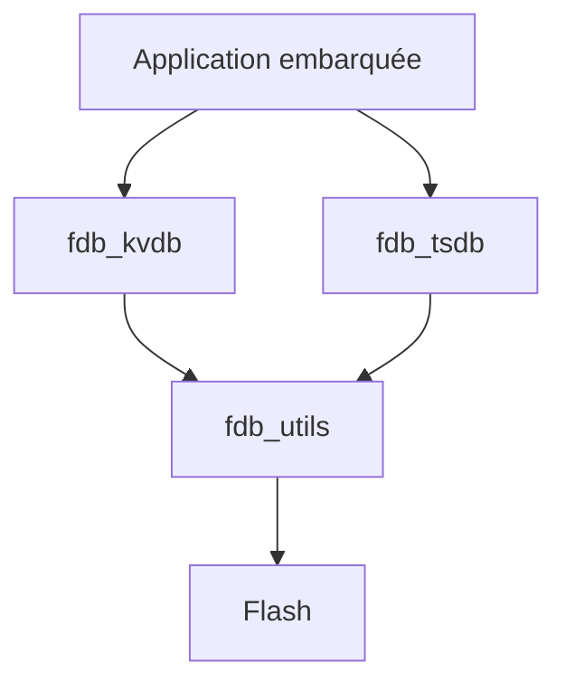

# armink/FlashDB

> Base de données embarquée clé-valeur et séries temporelles pour mémoire Flash de microcontrôleurs.

## Le problème
Stocker paramètres et mesures dans la Flash d'un objet connecté sans système de fichiers, sans l'user prématurément ni perdre des données à la coupure.

## Ce que ça fait vraiment
FlashDB propose deux modes : une base clé-valeur (chaînes et blobs, mise à niveau incrémentale après mise à jour du firmware) et une base de séries temporelles horodatées. Elle gère le nivellement d'usure, la protection contre les coupures de courant et plusieurs partitions ou instances. Le README annonce une RAM quasi nulle et donne des mesures : environ 4 ms l'insertion sur flash NOR W25Q64.

## Comment c'est branché
Schéma simplifié d'après la fiche, sans diagramme fourni.



## Essayer
```bash
msh />tsl bench
```
Cette commande de benchmark vient du README ; le guide de démarrage est dans la documentation en ligne.

## Coût et pièges
Gratuit, mais il faut le porter sur ta puce selon le document de portage. 188 issues ouvertes.

## Ce que ce n'est pas
Ce n'est pas une base SQL ni un outil pour serveur ou notebook : il vise le firmware embarqué. Aucun usage data ou IA.

## Alternatives
Aucune alternative n'est nommée dans le README.

## Pour toi
À ignorer : excellent pour l'embarqué, mais sans lien avec un profil data / IA / MLOps, sauf projet IoT.

