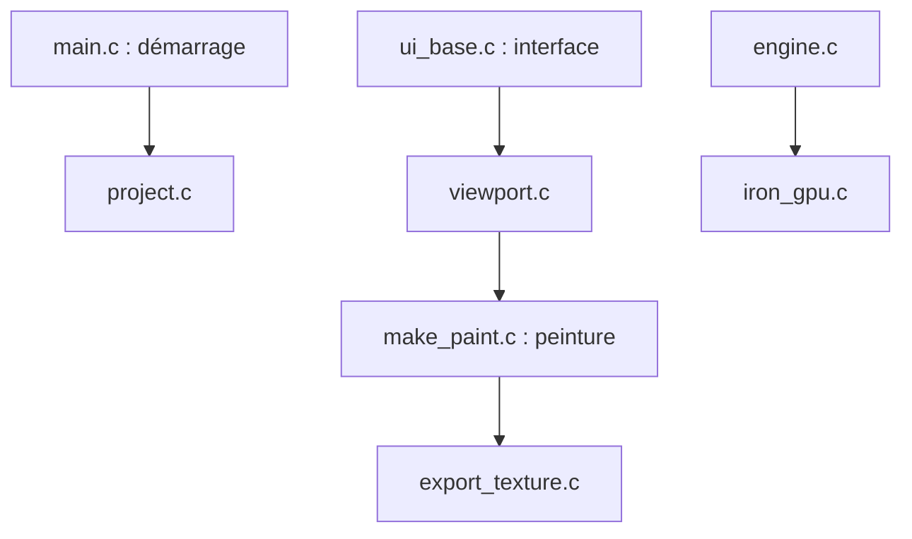

# armory3d/armorpaint

> 3D PBR texture painting software for artists, whose repository is aimed at developers.

## The problem
Painting physically realistic textures (color, roughness, metal) directly on a 3D model.

## What it actually does
ArmorPaint offers a painting interface with viewport, undo history, material and brush nodes, import and export of textures and projects, and neural image nodes. It is built on a homegrown engine (`iron_gpu.c`). The README warns that the repository is aimed at developers and that the distributed binaries are paid, to fund the project.

## How it is wired


## Trying it
```bash
git clone https://github.com/armory3d/armorpaint
cd armorpaint/paint
../base/make --run
```
Command given for Linux; Windows and macOS generate a project to open.

## Cost and gotchas
Free source, paid binaries. You need a compiler (Visual Studio with clang, clang on Linux, Xcode, Android Studio). The git version may be unstable and the license is "present but unidentified" according to GitHub.

## What it is not
Not an AI tool: the neural nodes are a detail. The README does not detail the interface features.

## Alternatives
No alternative named in the README.

## For you
Ignore: 3D art tool, far from your field; only the unclear license adds a hurdle.
