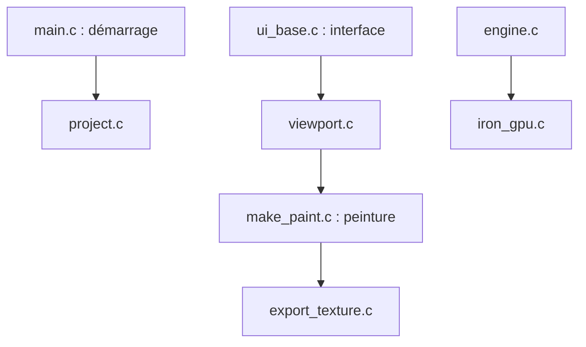

# armory3d/armorpaint

> Logiciel de peinture de textures 3D PBR pour artistes, dont le dépôt s'adresse aux développeurs.

## Le problème
Peindre des textures physiquement réalistes (couleur, rugosité, métal) directement sur un modèle 3D.

## Ce que ça fait vraiment
ArmorPaint propose une interface de peinture avec viewport, historique d'annulation, nœuds de matériaux et de pinceaux, import et export de textures et de projets, et des nœuds d'images neuronales. Il repose sur un moteur maison (`iron_gpu.c`). Le README prévient que le dépôt vise les développeurs et que les binaires distribués sont payants, pour financer le projet.

## Comment c'est branché


## Essayer
```bash
git clone https://github.com/armory3d/armorpaint
cd armorpaint/paint
../base/make --run
```
Commande indiquée pour Linux ; Windows et macOS génèrent un projet à ouvrir.

## Coût et pièges
Source gratuite, binaires payants. Il faut un compilateur (Visual Studio avec clang, clang sous Linux, Xcode, Android Studio). La version git peut être instable et la licence est « présente mais non identifiée » par GitHub.

## Ce que ce n'est pas
Ce n'est pas un outil d'IA : les nœuds neuronaux sont un détail. Le README ne détaille pas les fonctions de l'interface.

## Alternatives
Aucune alternative nommée dans le README.

## Pour toi
À ignorer : outil d'art 3D, loin de ton métier ; seule la licence floue ajoute un frein.

