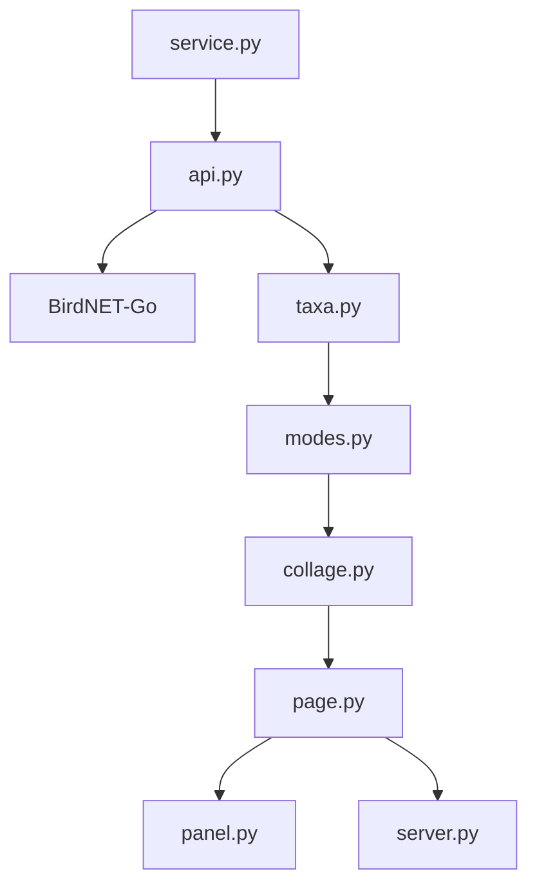

# arnegiacomo/fugleramme

> Bird frame for Raspberry Pi or homelab: local audio detection, rendered as old engravings.

## The problem
BirdNET-Go stations list species without a pleasant display. Nothing exists to turn them into a living picture on an e-ink screen.

## What it actually does
Queries the BirdNET-Go API (or a BirdWeather station), matches each species to an illustration (nearly 1,200 cutouts, 650 species, none AI-generated), sizes the birds by mass and recomposes the page only when the birds change. Output to an Inky Impression panel, TV or browser; admin page at `/admin`. Classification is done by BirdNET-Go, not by this repository.

## How it is wired


## Trying it
```bash
curl -fsSL https://raw.githubusercontent.com/arnegiacomo/fugleramme/main/install.sh | bash
docker run -d -p 8080:8080 -v fugleramme:/data \
  -e FUGLERAMME_DETECTOR_URL=http://birdnet.local:8080 \
  ghcr.io/arnegiacomo/fugleramme
uv sync && uv run fugleramme-fake-detector && uv run fugleramme-dev
```

## Cost and gotchas
Free, but hardware is needed for the full version: Pi 5, e-ink panel, microphone, frame. The author is affiliated with Pimoroni (referral links). The install script is run via curl piped into bash.

## What it is not
Not a bird identification tool. Not useful without a BirdNET-Go detector or a BirdWeather station.

## Alternatives
The README cites AvianVisitors, inky-bird-frame, HABirdDashboard and others, all with no shared code or art.

## For you
Ignore for your data / AI / MLOps work: a home automation and decoration project, unrelated to your pipelines.
