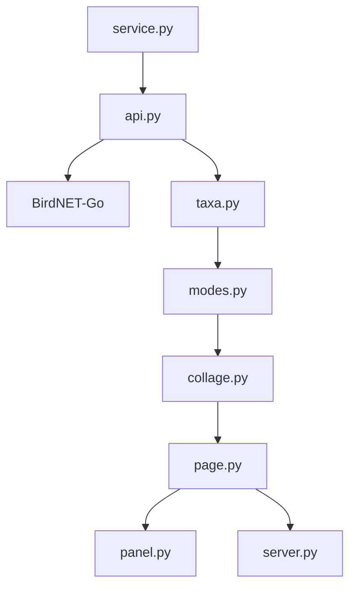

# arnegiacomo/fugleramme

> Cadre d'oiseaux pour Raspberry Pi ou homelab : détection audio locale, rendue en gravures anciennes.

## Le problème
Les stations BirdNET-Go listent des espèces sans rendu agréable. Rien pour en faire un tableau vivant sur écran e-ink.

## Ce que ça fait vraiment
Interroge l'API de BirdNET-Go (ou une station BirdWeather), associe chaque espèce à une illustration (près de 1 200 découpes, 650 espèces, aucune générée par IA), taille les oiseaux selon leur masse et recompose la page uniquement quand les oiseaux changent. Sortie sur panneau Inky Impression, TV ou navigateur ; page admin sur `/admin`. La classification est faite par BirdNET-Go, pas par ce dépôt.

## Comment c'est branché


## Essayer
```bash
curl -fsSL https://raw.githubusercontent.com/arnegiacomo/fugleramme/main/install.sh | bash
docker run -d -p 8080:8080 -v fugleramme:/data \
  -e FUGLERAMME_DETECTOR_URL=http://birdnet.local:8080 \
  ghcr.io/arnegiacomo/fugleramme
uv sync && uv run fugleramme-fake-detector && uv run fugleramme-dev
```

## Coût et pièges
Gratuit, mais matériel pour la version complète : Pi 5, panneau e-ink, micro, cadre. L'auteur est affilié à Pimoroni (liens de parrainage). Le script d'installation est exécuté via curl pipé dans bash.

## Ce que ce n'est pas
Pas un outil d'identification d'oiseaux. Pas utile sans détecteur BirdNET-Go ou station BirdWeather.

## Alternatives
Le README cite AvianVisitors, inky-bird-frame, HABirdDashboard et d'autres, tous sans code ni art partagés.

## Pour toi
À ignorer pour ton travail data / IA / MLOps : projet domotique et déco, sans lien avec tes pipelines.

