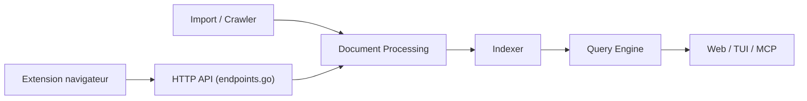

# asciimoo/hister

> Personal search engine that indexes the content of visited pages and local files.

## The problem
Finding a page you already read or a file you kept, when only titles and URLs are searchable in the browser history.

## What it actually does
A Go server (`hister listen`) indexes the full text of pages sent by a Firefox/Chrome extension, as well as imports (history, bookmarks, folders) and a crawler. Search is done through the web, a TUI, the command line or an MCP server. An optional semantic search goes through an embeddings endpoint that you configure. Multi-user mode with OAuth.

## How it is wired


## Trying it
```bash
chmod +x hister
./hister listen
# puis ouvrir l'interface web et installer l'extension Firefox ou Chrome
```

## Cost and gotchas
Free, with no telemetry and no mandatory cloud. Warning: semantic search sends the text of documents to the chosen embeddings endpoint. The server must stay running to index.

## What it is not
Not a web search engine: it only indexes what you visit or import. AGPL-3.0 license.

## Alternatives
No alternative named in the README.

## For you
Worth watching: handy as a local search memory, with an MCP server to expose it to an assistant; the AGPL is only a problem if you plan to redistribute it.
