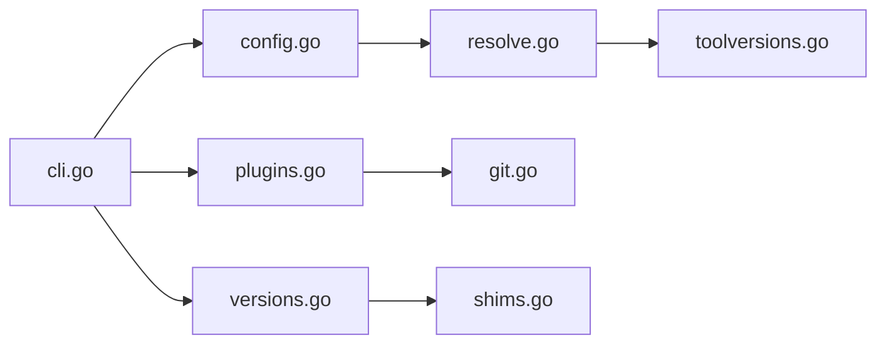

# asdf-vm/asdf

> Single per-project runtime version manager, extensible through plugins, for multi-language developers.

## The problem
One version manager per language (nvm, pyenv, rbenv...), each with its own commands.

## What it actually does
A CLI with per-language plugins. A `.tool-versions` file per project pins the versions, existing files (`.nvmrc`, `.node-version`, `.ruby-version`) are read, and executables go through shims. Versions change as you move through directories. Completion for Bash, Zsh, Fish, Elvish.

## How it is wired

## Trying it
No command documented in this README: it points to the asdf documentation to get started.

## Cost and gotchas
Free. Support for a language depends on the quality of its plugin, maintained separately.

## What it is not
Not a package manager or a virtual environment manager: it manages runtime versions. The README does not detail installation here.

## Alternatives
- gvm, nvm, rbenv, pyenv: specialized per language, which asdf aims to unify.

## For you
Adopt if you juggle versions of Python, Node, and MLOps tools: a single file per project makes the environment reproducible.
