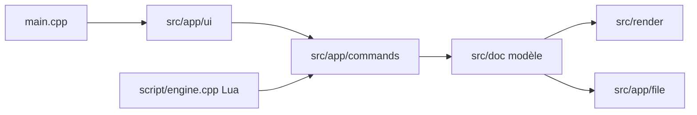

# aseprite/aseprite

> Animated pixel-art sprite editor, written in C++, with Lua scripting and a command line.

## The problem
Drawing pixel-art animations requires layers, keyframes and palettes that general-purpose editors handle poorly.

## What it actually does
Separate layers and frames, RGBA/indexed/grayscale modes, real-time preview with onion skinning, pixel-perfect tools, tiled mode, export to sprite sheets, GIF and PNG sequences. Lua scripts, an automation CLI, non-linear undo, crash recovery.

## How it is wired

## Trying it
The README contains no build or install command. Nothing invented.

## Cost and gotchas
Catalog: no license detected by GitHub. The README does not say whether the binary is paid; do not infer it. Usage status of the source code to be checked before redistribution.

## What it is not
Not a photo-editing or 3D-modeling tool.

## Alternatives
No alternative named in the README.

## For you
Ignore: a pixel-art creation tool, unrelated to data/AI work; the license remains to be checked.
