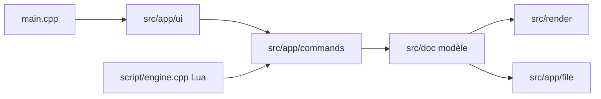

# aseprite/aseprite

> Éditeur de sprites animés en pixel art, en C++, avec scripts Lua et ligne de commande.

## Le problème
Dessiner des animations en pixel art demande des calques, des images clés et des palettes que les éditeurs généralistes gèrent mal.

## Ce que ça fait vraiment
Calques et images distincts, modes RGBA/indexé/niveaux de gris, aperçu temps réel avec onion skinning, outils pixel perfect, mode tuilé, export en planches de sprites, GIF, séquences PNG. Scripts Lua, CLI d'automatisation, annulation non linéaire, récupération après plantage.

## Comment c'est branché

## Essayer
Le README ne contient aucune commande de compilation ni d'installation. Rien d'inventé.

## Coût et pièges
Catalogue : aucune licence détectée par GitHub. Le README ne dit pas si le binaire est payant ; ne pas déduire. Statut d'usage du code source à vérifier avant redistribution.

## Ce que ce n'est pas
Pas un outil de retouche photo ni de modélisation 3D.

## Alternatives
Aucune alternative nommée dans le README.

## Pour toi
Ignorer : outil de création de pixel art, sans rapport avec le travail data/IA ; la licence reste à vérifier.

