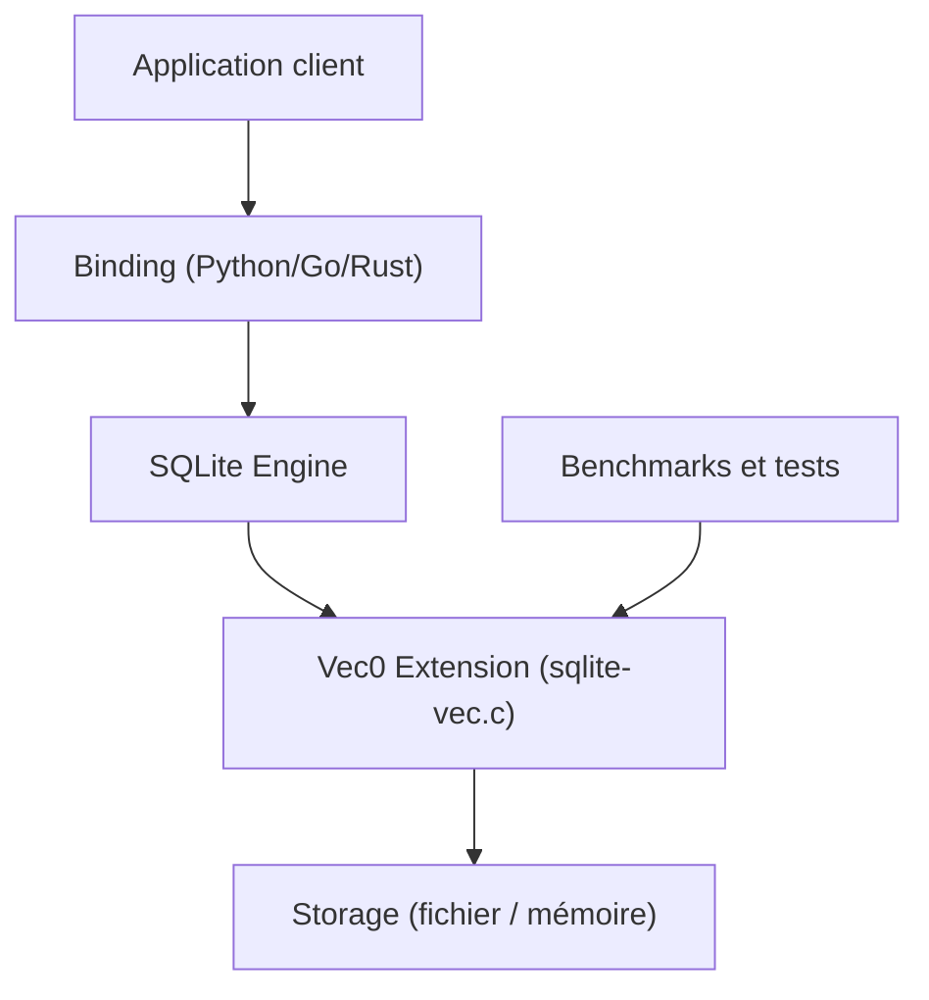

# asg017/sqlite-vec

> Small, dependency-free C extension for SQLite vector search, successor to sqlite-vss.

## The problem
Run nearest-neighbor search on embeddings without standing up a vector database server.

## What it actually does
Adds `vec0` virtual tables to SQLite storing float, int8 and binary vectors, queryable in SQL (KNN). Pure C, runs anywhere SQLite runs, including WASM. Bindings exist for Python, Node, Ruby, Go, Rust, Datasette.

## How it is wired


## Trying it
```bash
pip install sqlite-vec
npm install sqlite-vec
cargo add sqlite-vec
```
```sql
.load ./vec0
create virtual table vec_examples using vec0(sample_embedding float[8]);
```

## Cost and gotchas
Free. The README warns that the version is pre-v1: breaking changes are possible. Embeddings must be produced elsewhere (sqlite-rembed, sqlite-lembed, both cited).

## What it is not
Not an embedding engine nor a distributed vector database. "Fast enough" is the stated goal, not maximum performance.

## Alternatives
sqlite-vss (predecessor), sqlite-rembed and sqlite-lembed to generate the embeddings.

## For you
Adopt it for local or embedded RAG: zero servers, familiar SQL; keep the pre-v1 status in mind before locking in a dependency.
