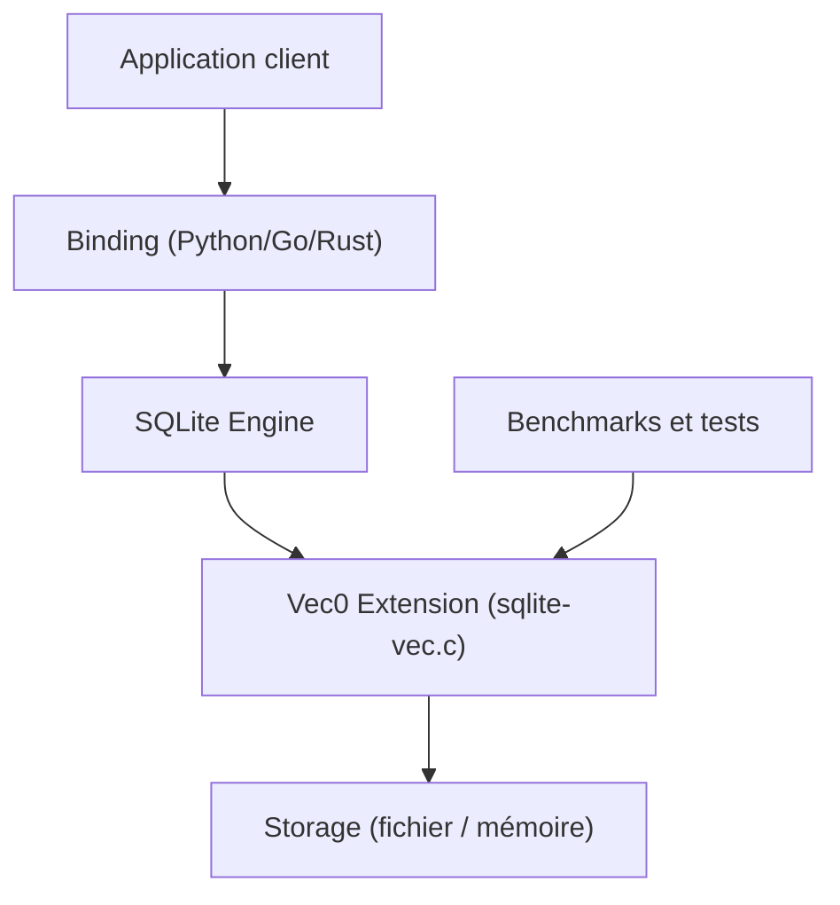

# asg017/sqlite-vec

> Extension SQLite en C pour la recherche vectorielle, petite, sans dépendance, successeur de sqlite-vss.

## Le problème
Faire de la recherche de plus proches voisins sur des embeddings sans monter un serveur de base vectorielle.

## Ce que ça fait vraiment
Ajoute à SQLite des tables virtuelles `vec0` stockant des vecteurs float, int8 et binaires, interrogeables en SQL (KNN). Pur C, tourne partout où SQLite tourne, y compris WASM. Des liaisons existent pour Python, Node, Ruby, Go, Rust, Datasette.

## Comment c'est branché


## Essayer
```bash
pip install sqlite-vec
npm install sqlite-vec
cargo add sqlite-vec
```
```sql
.load ./vec0
create virtual table vec_examples using vec0(sample_embedding float[8]);
```

## Coût et pièges
Gratuit. Le README avertit que la version est pré-v1 : changements cassants possibles. Les embeddings sont à produire ailleurs (sqlite-rembed, sqlite-lembed, cités).

## Ce que ce n'est pas
Pas un moteur d'embeddings ni une base vectorielle distribuée. « Assez rapide » est l'objectif annoncé, pas la performance maximale.

## Alternatives
sqlite-vss (prédécesseur), sqlite-rembed et sqlite-lembed pour générer les embeddings.

## Pour toi
À adopter pour du RAG local ou embarqué : zéro serveur, SQL familier ; garde en tête le statut pré-v1 avant de figer une dépendance.

