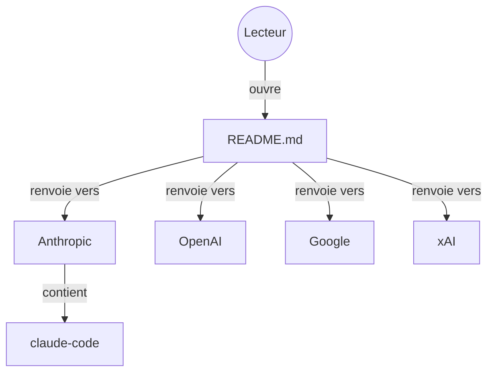

# asgeirtj/system_prompts_leaks

> Archive of leaked system prompts from ChatGPT, Claude, Gemini and about thirty other products.

## The problem
The hidden instructions that govern an assistant are invisible. To design your own prompts or compare products, you want to read them.

## What it actually does
A repository of documents, organized by vendor (Anthropic, OpenAI, Google, xAI, Microsoft, misc). The README keeps a table of recent additions and of prompts per model, including Claude Code, Codex, Cursor or Perplexity. A few copied Claude skill scripts (design system exporter, research workflow) are archived there but not executed by the repository.

## How it is wired


## Trying it
```bash
# Aucune commande documentée : on parcourt le README et les dossiers par éditeur.
```

## Cost and gotchas
No cost. The provenance of the prompts cannot be verified: they are extracted unofficially and may be outdated or inaccurate. The license is CC0.

## What it is not
It is not an official source nor a tool. No application runs here, only text. The README claims to cover "every version since May 2025", which cannot be demonstrated.

## Alternatives
No alternative named in the README.

## For you
To consult for inspiration on the structure of agent prompts; occasional reading, with no tool value.
