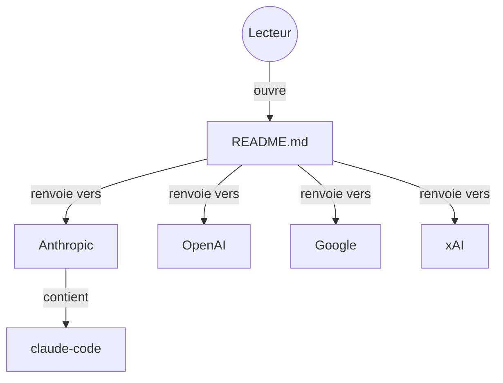

# asgeirtj/system_prompts_leaks

> Archive de prompts système divulgués de ChatGPT, Claude, Gemini et d'une trentaine d'autres produits.

## Le problème
Les consignes cachées qui régissent un assistant sont invisibles. Pour concevoir ses propres prompts ou comparer les produits, on veut les lire.

## Ce que ça fait vraiment
Un dépôt de documents, classé par éditeur (Anthropic, OpenAI, Google, xAI, Microsoft, divers). Le README tient un tableau des ajouts récents et des prompts par modèle, y compris Claude Code, Codex, Cursor ou Perplexity. Quelques scripts de skills Claude copiés (exporteur de design system, workflow de recherche) y sont archivés mais pas exécutés par le dépôt.

## Comment c'est branché


## Essayer
```bash
# Aucune commande documentée : on parcourt le README et les dossiers par éditeur.
```

## Coût et pièges
Aucun coût. La provenance des prompts n'est pas vérifiable : ils sont extraits de façon non officielle et peuvent être obsolètes ou inexacts. La licence est CC0.

## Ce que ce n'est pas
Ce n'est pas une source officielle ni un outil. Aucune application ne tourne ici, seulement du texte. Le README affirme couvrir « chaque version depuis mai 2025 », ce qui n'est pas démontrable.

## Alternatives
Aucune alternative nommée dans le README.

## Pour toi
À consulter pour s'inspirer de la structure des prompts d'agents ; consultation ponctuelle, sans valeur d'outil.

