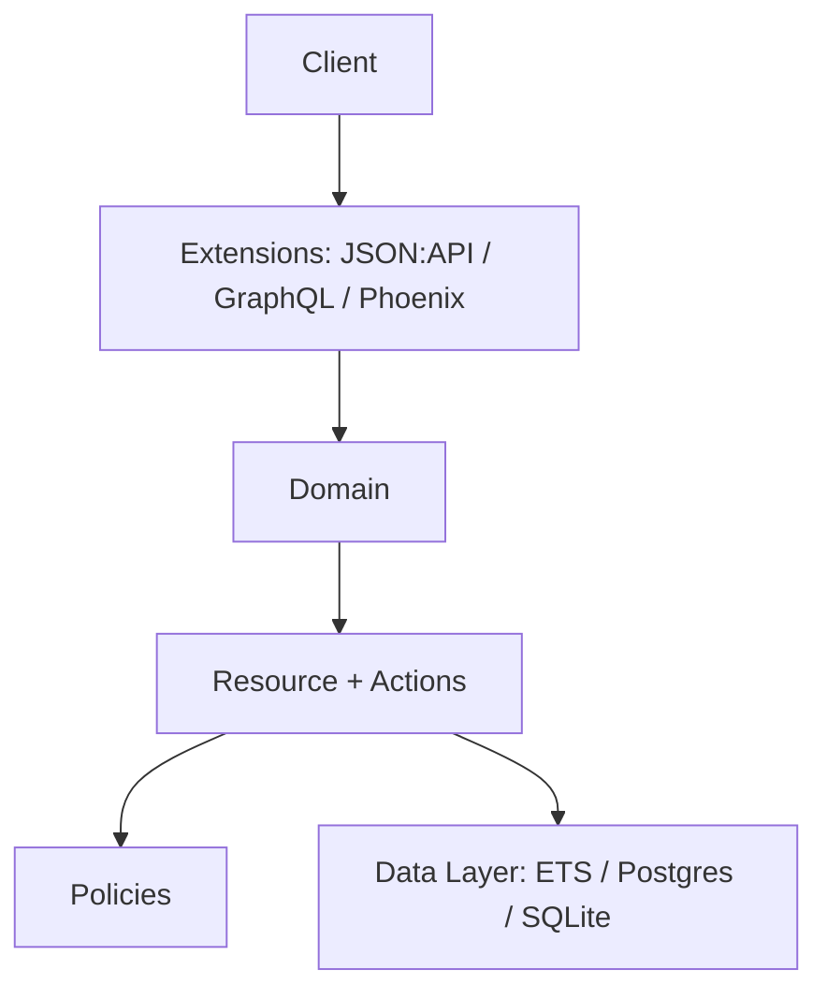

# ash-project/ash

> Declarative Elixir framework for resources and actions, for resource-oriented applications.

## The problem
Business applications keep repeating hand-written models, validations, authorizations and APIs.

## What it actually does
Describes in a DSL resources (attributes, relationships, actions, calculations, validations, authorization policies), domains, a notification system and Reactor for multi-step actions. ETS and Mnesia data layers included; extensions for PostgreSQL, SQLite, JSON:API, GraphQL, Phoenix, authentication, AshAI (structured outputs, MCP, vectorization) and AshOban. The GitHub catalog detects no license, but the README header states SPDX MIT: to be verified.

## How it is wired

## Trying it
No command in the README; it points to the "Get Started" tutorial (Livebook) and to the documentation.

## Cost and gotchas
Free. You need to know Elixir and Ash's DSL; 3.0 migration is documented.

## What it is not
Not a data tool: it is an Elixir application framework.

## Alternatives
No alternative named in the README (an "Alternatives" page exists in its documentation).

## For you
Keep an eye on it: the AshAI extension (MCP, vectorization) may be of interest if you do AI under Elixir, otherwise little relevance.
