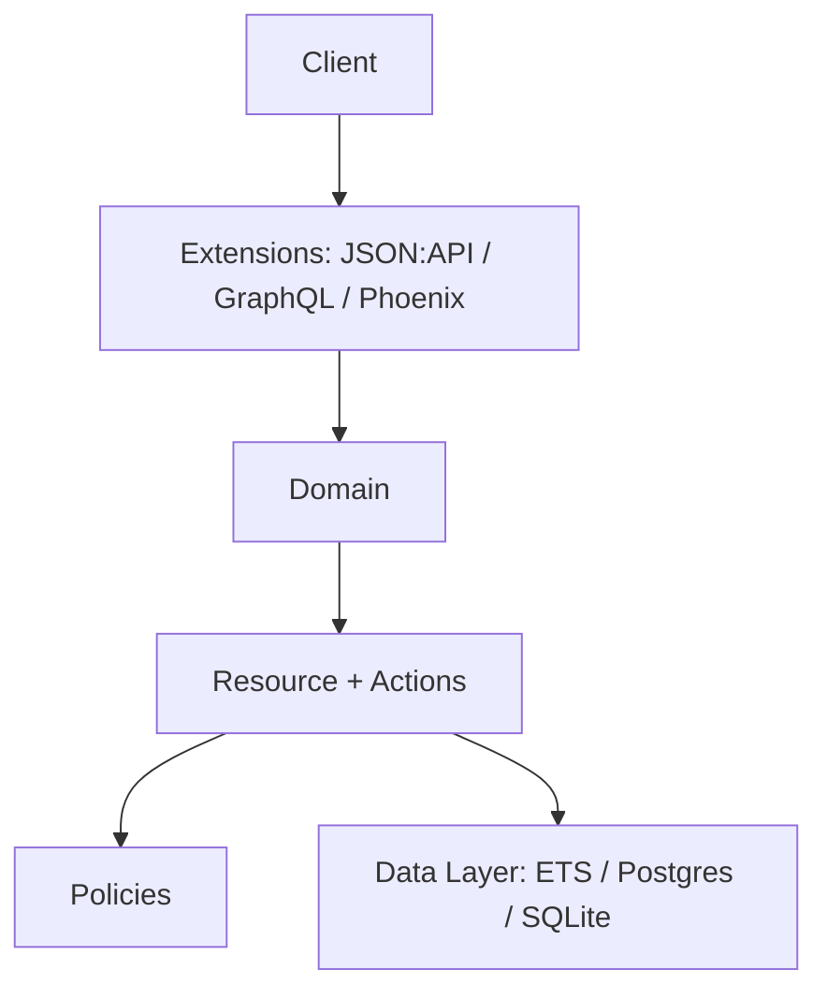

# ash-project/ash

> Framework Elixir déclaratif de ressources et d'actions, pour applications orientées ressources.

## Le problème
Les applications métier répètent modèles, validations, autorisations et API écrits à la main.

## Ce que ça fait vraiment
Décrit en DSL des ressources (attributs, relations, actions, calculs, validations, politiques d'autorisation), des domaines, un système de notifications et Reactor pour les actions à plusieurs étapes. Couches de données ETS et Mnesia incluses ; extensions pour PostgreSQL, SQLite, JSON:API, GraphQL, Phoenix, authentification, AshAI (sorties structurées, MCP, vectorisation) et AshOban. Le catalogue GitHub ne détecte aucune licence, mais l'en-tête du README indique SPDX MIT : à vérifier.

## Comment c'est branché

## Essayer
Aucune commande dans le README ; il renvoie au tutoriel « Get Started » (Livebook) et à la documentation.

## Coût et pièges
Gratuit. Il faut connaître Elixir et le DSL d'Ash ; migration 3.0 documentée.

## Ce que ce n'est pas
Pas un outil data : c'est un cadre applicatif Elixir.

## Alternatives
Aucune alternative nommée dans le README (une page « Alternatives » existe dans sa documentation).

## Pour toi
À surveiller : l'extension AshAI (MCP, vectorisation) peut intéresser si tu fais de l'IA sous Elixir, sinon peu pertinent.

