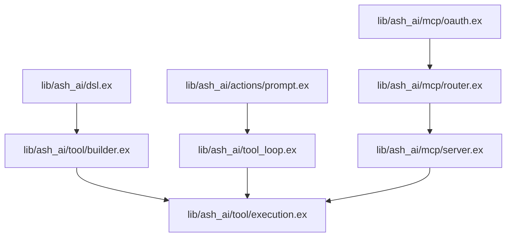

# ash-project/ash_ai

> Elixir extension for the Ash framework: expose actions as LLM tools and as an MCP server.

## The problem
Plugging an LLM into the actions of an Ash application means rewriting the tools, authentication and call loop by hand.

## What it actually does
A DSL declares tools on Ash resources. They are exposed to the LLM by the tool loop (ToolLoop, ReqLLM) and to external clients by an MCP server protected by OAuth 2.1 or API keys. It adds prompt-backed actions, evaluation actions, embeddings (vectorization) and a generated chat.

## How it is wired


## Trying it
```bash
mix igniter.install ash_ai
mix ash_ai.gen.mcp
mix ash_ai.gen.chat --live
```

## Cost and gotchas
API key from the LLM provider (OpenAI by default, via ReqLLM) at your expense; Postgres and Phoenix for the generated chat. The README header says MIT but the catalog sees no license.

## What it is not
Not an independent agent framework: it only works inside an Ash/Elixir application. The generated chat is presented as experimental.

## Alternatives
No alternative named (migration from LangChain to ReqLLM mentioned).

## For you
Worth watching: a good example of an MCP server with OAuth, but useful only if you already work in Elixir/Ash.
