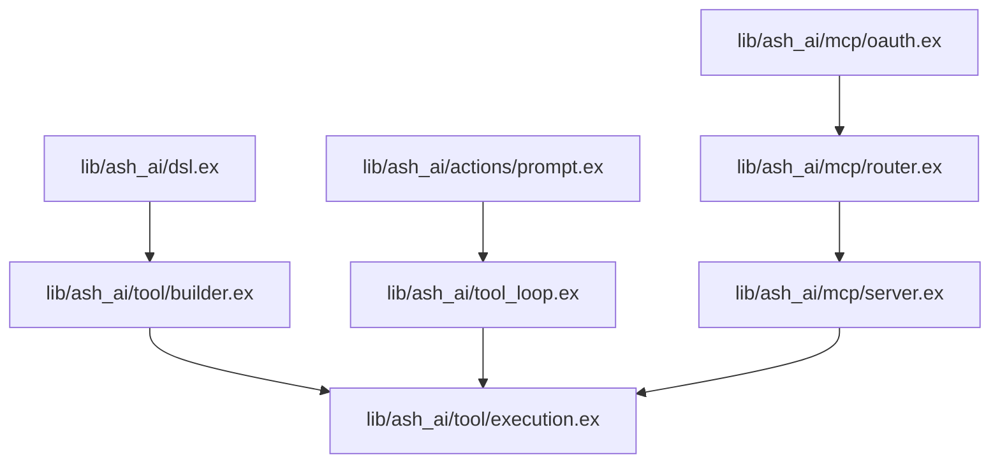

# ash-project/ash_ai

> Extension Elixir pour le framework Ash : exposer des actions en outils LLM et en serveur MCP.

## Le problème
Brancher un LLM sur les actions d'une application Ash demande de réécrire les outils, l'authentification et la boucle d'appels à la main.

## Ce que ça fait vraiment
Un DSL déclare des outils sur les ressources Ash. Ils sont exposés au LLM par la boucle d'outils (ToolLoop, ReqLLM) et aux clients externes par un serveur MCP protégé par OAuth 2.1 ou clés d'API. Elle ajoute des actions adossées à un prompt, des actions d'évaluation, des embeddings (vectorisation) et un chat généré.

## Comment c'est branché


## Essayer
```bash
mix igniter.install ash_ai
mix ash_ai.gen.mcp
mix ash_ai.gen.chat --live
```

## Coût et pièges
Clé d'API du fournisseur LLM (OpenAI par défaut, via ReqLLM) à ta charge ; Postgres et Phoenix pour le chat généré. L'en-tête du README indique MIT mais le catalogue ne voit aucune licence.

## Ce que ce n'est pas
Pas un framework d'agents indépendant : il ne sert que dans une application Ash/Elixir. Le chat généré est présenté comme expérimental.

## Alternatives
Aucune alternative nommée (migration depuis LangChain vers ReqLLM mentionnée).

## Pour toi
À surveiller : bon exemple de serveur MCP avec OAuth, mais utile seulement si tu travailles déjà en Elixir/Ash.

