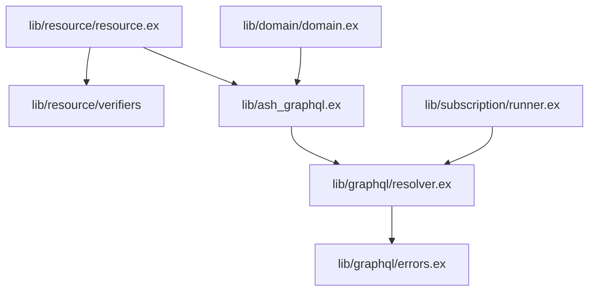

# ash-project/ash_graphql

> Extension of the Ash framework to generate GraphQL APIs, via Absinthe, from Elixir resources.

## The problem
Exposing Ash resources over GraphQL requires rewriting types and resolvers by hand.

## What it actually does
The extension reads the configuration of Ash resources and domains, verifies it, then generates the Absinthe schema. At runtime, a resolver handles queries, errors and subscriptions. The README mostly lists guides (authorization, Relay, JSON, enumerations).

## How it is wired


## Trying it
```bash
# Aucune commande dans le README : renvoie vers les tutoriels
```

## Cost and gotchas
Free, but Elixir and the Ash framework are required. The catalog sees no license, whereas an SPDX header in the README indicates MIT.

## What it is not
Not a standalone GraphQL server: an add-on module for Ash.

## Alternatives
- Absinthe: GraphQL library on which the extension relies.

## For you
Ignore: only useful if your application is already in Elixir with Ash.
