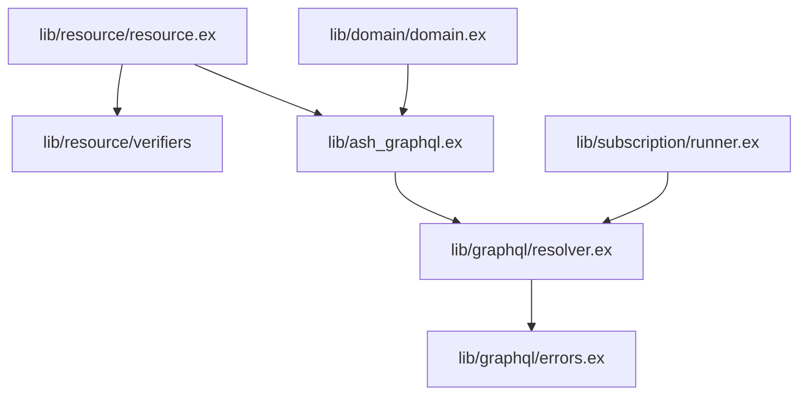

# ash-project/ash_graphql

> Extension du framework Ash pour générer des API GraphQL, via Absinthe, depuis des ressources Elixir.

## Le problème
Exposer des ressources Ash en GraphQL demande de réécrire types et résolveurs à la main.

## Ce que ça fait vraiment
L'extension lit la configuration des ressources et des domaines Ash, la vérifie, puis génère le schéma Absinthe. À l'exécution, un resolver traite requêtes, erreurs et abonnements. Le README liste surtout des guides (autorisation, Relay, JSON, énumérations).

## Comment c'est branché


## Essayer
```bash
# Aucune commande dans le README : renvoie vers les tutoriels
```

## Coût et pièges
Gratuit, mais Elixir et le framework Ash sont nécessaires. Le catalogue ne voit pas de licence, alors qu'un en-tête SPDX du README indique MIT.

## Ce que ce n'est pas
Pas un serveur GraphQL autonome : un module complémentaire d'Ash.

## Alternatives
- Absinthe : bibliothèque GraphQL sur laquelle l'extension s'appuie.

## Pour toi
Ignorer : utile uniquement si ton application est déjà en Elixir avec Ash.

