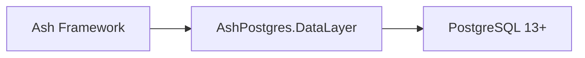

# ash-project/ash_postgres

> PostgreSQL data layer of the Elixir framework Ash.

## The problem
Not documented in detail: the README contains only a table of contents of links.

## What it actually does
Provides Ash Framework with a PostgreSQL data layer (minimum version 13.0). The table of contents mentions: polymorphic resources, migrations, expressions, manual relationships, partitioned tables, schema-based multitenancy, read replicas.

## How it is wired
Simplified diagram based on the sheet, no diagram provided.

## Trying it
No command documented.

## Cost and gotchas
PostgreSQL 13 minimum. The catalog reports no license, whereas the README header mentions MIT: to be confirmed. Elixir is required (not listed in the prerequisites).

## What it is not
Not a standalone ORM: it only works with Ash. The README does not explain installation.

## Alternatives
No alternative named in the README.

## For you
Worth watching only if your team uses Elixir: little direct link with data / AI / MLOps.
