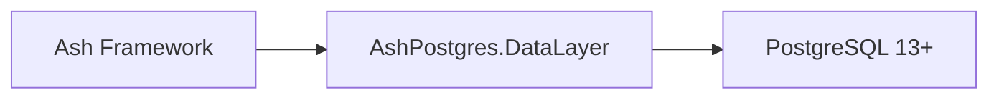

# ash-project/ash_postgres

> Couche de données PostgreSQL du framework Elixir Ash.

## Le problème
Non documenté en détail : le README ne contient qu'un sommaire de liens.

## Ce que ça fait vraiment
Fournit à Ash Framework une couche de données PostgreSQL (version minimale 13.0). Le sommaire cite : ressources polymorphes, migrations, expressions, relations manuelles, tables partitionnées, multi-tenance par schéma, réplicas en lecture.

## Comment c'est branché
Schéma simplifié d'après la fiche, sans diagramme fourni.

## Essayer
Aucune commande documentée.

## Coût et pièges
PostgreSQL 13 minimum. Le catalogue indique aucune licence, alors que l'en-tête du README mentionne MIT : à confirmer. Elixir est nécessaire (non listé dans les prérequis).

## Ce que ce n'est pas
Pas un ORM autonome : il ne fonctionne qu'avec Ash. Le README n'explique pas l'installation.

## Alternatives
Aucune alternative nommée dans le README.

## Pour toi
À surveiller seulement si ton équipe fait de l'Elixir : peu de lien direct avec data / IA / MLOps.

