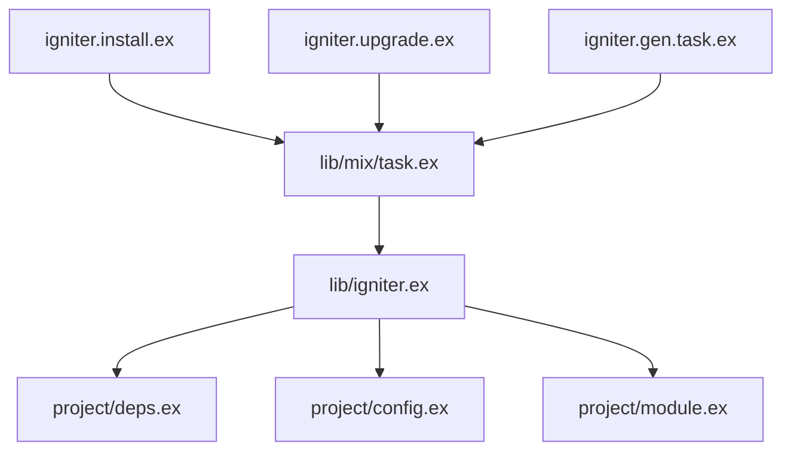

# ash-project/igniter

> Elixir code generation and modification framework, for library users and authors.

## The problem
Installing an Elixir dependency and adapting the project's configuration and code is done by hand.

## What it actually does
Mix tasks (`igniter.install`, `igniter.upgrade`, refactorings) add dependencies, apply code fixes and rename functions. Library authors write generators that create and modify files semantically. The repository declares no license on GitHub, but the README header says MIT.

## How it is wired


## Trying it
```bash
mix archive.install hex igniter_new
mix igniter.new app_name --install ash,ecto
mix igniter.install <paquet>
```

## Cost and gotchas
Free. It needs Elixir 1.15 or higher (1.17 recommended), outside the prerequisites list. License to be confirmed: GitHub detects none.

## What it is not
It is not a generator for other languages: it targets Elixir (Mix) projects.

## Alternatives
No alternative named in the README.

## For you
Ignore unless you have Elixir or Ash projects: without Elixir in your stack, it is of no use.
