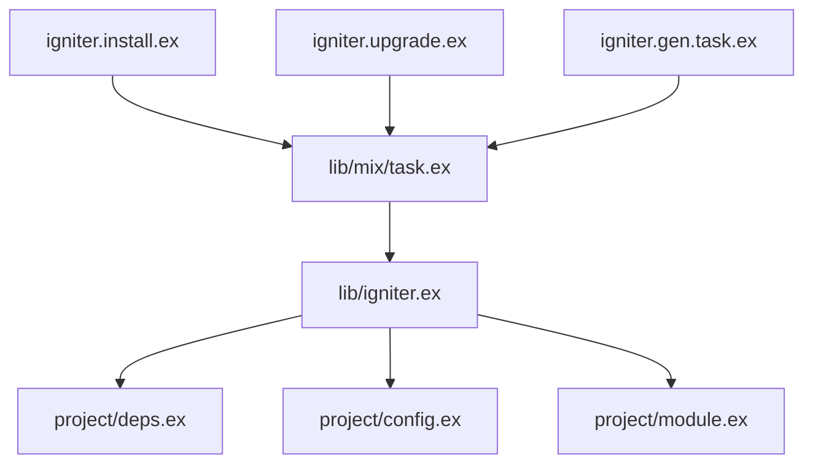

# ash-project/igniter

> Framework de génération et de modification de code Elixir, pour utilisateurs et auteurs de bibliothèques.

## Le problème
Installer une dépendance Elixir et adapter la configuration et le code du projet se fait à la main.

## Ce que ça fait vraiment
Des tâches Mix (`igniter.install`, `igniter.upgrade`, refactorisations) ajoutent des dépendances, appliquent des correctifs de code et renomment des fonctions. Les auteurs de bibliothèques écrivent des générateurs qui créent et modifient les fichiers de façon sémantique. Le dépôt ne déclare pas de licence côté GitHub, mais l'en-tête du README indique MIT.

## Comment c'est branché


## Essayer
```bash
mix archive.install hex igniter_new
mix igniter.new app_name --install ash,ecto
mix igniter.install <paquet>
```

## Coût et pièges
Gratuit. Il faut Elixir 1.15 ou plus (1.17 recommandé), hors liste de prérequis. Licence à confirmer : GitHub n'en détecte aucune.

## Ce que ce n'est pas
Ce n'est pas un générateur pour d'autres langages : il vise les projets Elixir (Mix).

## Alternatives
Aucune alternative nommée dans le README.

## Pour toi
À ignorer sauf projets Elixir ou Ash : sans Elixir dans ta pile, il n'a aucune utilité.

