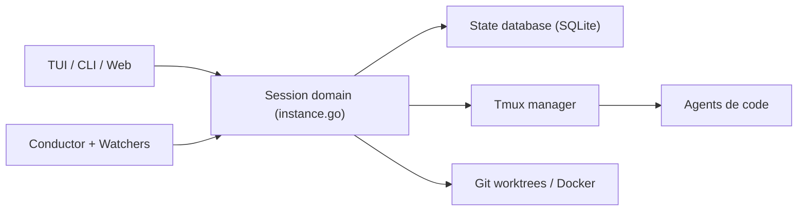

# asheshgoplani/agent-deck

> Terminal console to supervise, fork and orchestrate several coding-agent sessions via tmux.

## The problem
With several agents (Claude Code, OpenCode, Codex…) on several projects, you lose track of which one is running, waiting or has failed.

## What it actually does
A Go binary with a Bubble Tea TUI, sessions in tmux, live statuses, groups, search, session forking with context, Git worktrees, Docker sandbox, MCP/skills management, cost and quota tracking, remote instances over SSH, and a local web interface. "Conductors" are supervisor agents that can be driven from Telegram or Slack, with watchers (GitHub, ntfy, webhook).

## How it is wired


## Trying it
```bash
curl -fsSL https://raw.githubusercontent.com/asheshgoplani/agent-deck/main/install.sh | bash
agent-deck
agent-deck add . -c claude
agent-deck web
```

## Cost and gotchas
Free; the agents you drive remain at your expense. 126 open issues and a very long README. Web mode outside loopback requires a token. Telemetry is disabled by default (opt-in).

## What it is not
Not an agent itself: a session manager. Windows via WSL only.

## Alternatives
The README only compares it to plain tmux, of which it is a layer.

## For you
Worth watching: useful if you run several coding agents in parallel, but single maintainer and a very broad feature surface.
