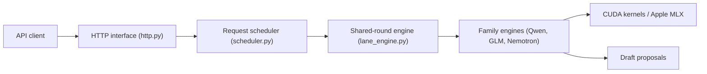

# ashhart/TensorFold

> OpenAI-compatible API inference server for Apple Silicon and NVIDIA GPUs, with exact speculative decoding.

## The problem
Serving large quantized models locally requires kernels tailored to each model family and efficient prompt resumption.

## What it actually does
Each family (Qwen3.8, Nemotron 3.5, GLM-5.3-Flash, Gemma 4, DeepSeek-V4-Flash…) brings its own MLX or CUDA kernels and its own draft verifier. A draft is accepted only if it equals the token the same engine would have produced serially. The server handles the prefix cache (with disk snapshots on MLX), several concurrent requests, image input (`--vision` option) and two CUDA ranks.

## How it is wired


## Trying it
```bash
python -m pip install git+https://github.com/ashhart/TensorFold.git
tensorfold serve Vontra/NVIDIA-Nemotron-3.5-Lightning-30B-A3B-MLX-4bit
tensorfold pull Vontra/Qwen3.8-27B-MLX-4bit z-lab/Qwen3.8-27B-DFlash2
tensorfold update --check
```

## Cost and gotchas
Python 3.11+, MLX 0.32.2+ on Mac; NVIDIA PyTorch container for CUDA. A Mac with 64 GB or more for large models; the memory table is almost everywhere at `TBD`. Version check at startup (`--no-update-check`). One GLM draft checkpoint has a non-commercial license.

## What it is not
Not a server with figures in the README: measurements are deferred to the release notes. The exactness holds for a single engine, not between MLX and CUDA.

## Alternatives
No alternative cited; the README compares against "standard servers" without naming them.

## For you
Worth watching: a rigorous approach to exact speculative decoding, but a young project, maintained by one person, with hardware qualification still incomplete.
