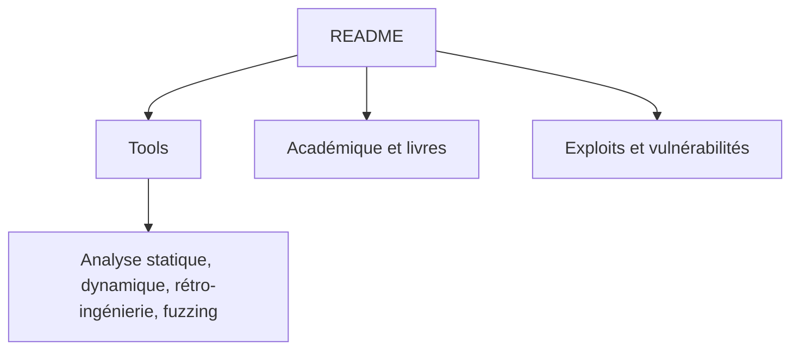

# ashishb/android-security-awesome

> List of Android security resources: tools, publications, vulnerabilities, for mobile security analysts.

## The problem
Tools for analyzing and reverse-engineering Android applications are scattered, and many have disappeared.

## What it actually does
A categorized catalog: online analyzers, static and dynamic analysis, vulnerability scanners, reverse engineering, fuzzing, deliberately vulnerable training applications, articles, malware. Dead entries are struck through. Some listed tools are offensive; the list itself contains no code.

## How it is wired
Simplified diagram based on the sheet, no diagram provided.



## Trying it
```bash
# Rien à installer : la liste se lit dans le README.
```

## Cost and gotchas
Free. Some listed tools are paid ("not free"). Links age: many entries are struck through.

## What it is not
Not a tool: a list of links. No quality assessment of the entries.

## Alternatives
In the list: Mobile-Security-Framework MobSF, Frida, Jadx.

## For you
Ignore for a data / AI / MLOps profile: mobile security is off-topic, useful only if you audit Android applications.
