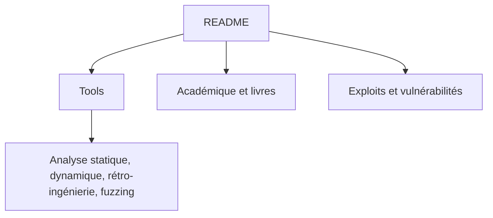

# ashishb/android-security-awesome

> Liste de ressources sur la sécurité Android : outils, publications, vulnérabilités, pour analystes sécurité mobile.

## Le problème
Les outils d'analyse et de rétro-ingénierie d'applications Android sont dispersés et beaucoup ont disparu.

## Ce que ça fait vraiment
Catalogue classé : analyseurs en ligne, analyse statique et dynamique, scanners de vulnérabilités, rétro-ingénierie, fuzzing, applications vulnérables d'entraînement, articles, malwares. Les entrées mortes sont barrées. Certains outils listés sont offensifs ; la liste elle-même ne contient pas de code.

## Comment c'est branché
Schéma simplifié d'après la fiche, sans diagramme fourni.



## Essayer
```bash
# Rien à installer : la liste se lit dans le README.
```

## Coût et pièges
Gratuit. Certains outils listés sont payants (« not free »). Les liens vieillissent : beaucoup d'entrées sont barrées.

## Ce que ce n'est pas
Pas un outil : une liste de liens. Aucune évaluation de qualité des entrées.

## Alternatives
Dans la liste : Mobile-Security-Framework MobSF, Frida, Jadx.

## Pour toi
À ignorer pour un profil data / IA / MLOps : sécurité mobile hors sujet, utile seulement si tu audites des applications Android.

