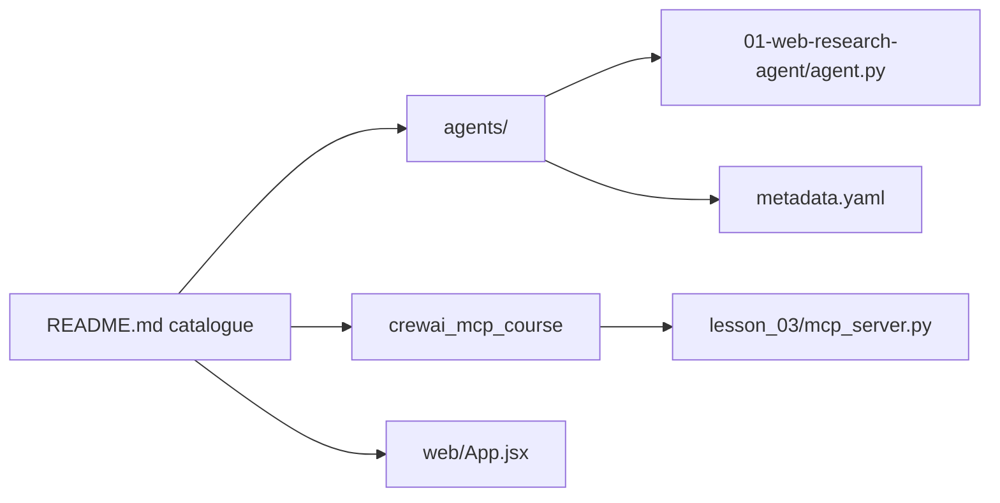

# ashishpatel26/500-AI-Agents-Projects

> A catalogue of AI agent use cases by industry and framework, with a few runnable examples.

## The problem
Finding your way among agent frameworks and locating concrete examples by industry takes time.

## What it actually does
Mostly tables of links to external projects (healthcare, finance, cybersecurity…) and CrewAI, AutoGen, Agno, LangGraph notebooks. The `agents/` folder contains 21 standalone Python agents (each with its own `requirements.txt` and `.env.example`), plus a CrewAI + MCP course and a React catalogue site.

## How it is wired


## Trying it
```bash
git clone https://github.com/ashishpatel26/500-AI-Agents-Projects.git
cd agents/01-web-research-agent
pip install -r requirements.txt
cp .env.example .env
python agent.py
```

## Cost and gotchas
You must supply an LLM API key for each example. The "500+" figure mostly counts external links, which are unverified.

## What it is not
Not a framework or a shared runtime; the quality of the linked projects is uneven.

## Alternatives
The README compares LangGraph, CrewAI, AutoGen, Agno and LlamaIndex as frameworks, not as alternatives to the list.

## For you
A good entry point for finding an example of a pattern; do not rely on it as a quality reference.
