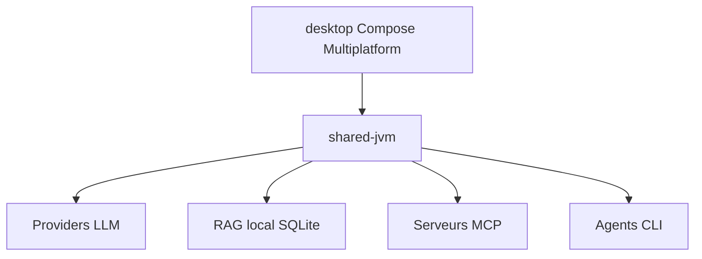

# askimo-ai/askimo

> Desktop application that brings together all AI models, with local RAG, CLI agents and workflows.

## The problem
Juggling chat tabs, local models, search across your files and command-line agents, with no shared history.

## What it actually does
- One chat for OpenAI, Claude, Gemini, Grok, Ollama, LM Studio, vLLM or any OpenAI-compatible endpoint.
- Local RAG over folders, files and URLs, hybrid BM25 and vector search, SQLite storage.
- Delegates goals to Claude Code, Codex or Antigravity; shared skills and YAML "Plans" workflows.
- Script execution, MCP tools, local voice (Whisper, Piper).

## How it is wired

Simplified diagram based on the sheet, no diagram provided.

## Trying it
```bash
git clone https://github.com/askimo-ai/askimo.git
cd askimo
./gradlew :desktop:run
./gradlew :desktop:package
```

## Cost and gotchas
Free; API key of the chosen provider, or local Ollama. Building from source: JDK 25 or later. Installers are to be downloaded from the project page.

## What it is not
Not a simple chat client: it also drives agents and runs scripts. Local models need memory on top of the application's 50 to 300 MB.

## Alternatives
No alternative named in the README.

## For you
Worth watching: handy for testing several models with a local RAG without sending data out; the scope is broad, to be weighed against your current tools.
