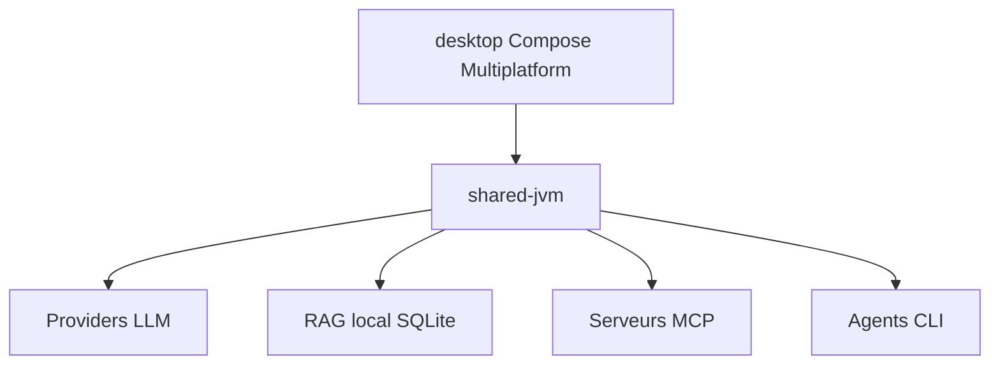

# askimo-ai/askimo

> Application de bureau qui réunit tous les modèles d'IA, avec RAG local, agents CLI et workflows.

## Le problème
Jongler entre onglets de chat, modèles locaux, recherche dans ses fichiers et agents en ligne de commande, sans historique commun.

## Ce que ça fait vraiment
- Un chat vers OpenAI, Claude, Gemini, Grok, Ollama, LM Studio, vLLM ou tout endpoint compatible OpenAI.
- RAG local sur dossiers, fichiers et URL, recherche hybride BM25 et vecteurs, stockage SQLite.
- Délègue des objectifs à Claude Code, Codex ou Antigravity ; skills partagés et workflows « Plans » en YAML.
- Exécution de scripts, outils MCP, voix locale (Whisper, Piper).

## Comment c'est branché

Schéma simplifié d'après la fiche, sans diagramme fourni.

## Essayer
```bash
git clone https://github.com/askimo-ai/askimo.git
cd askimo
./gradlew :desktop:run
./gradlew :desktop:package
```

## Coût et pièges
Gratuit ; clé d'API du fournisseur choisi ou Ollama local. Compilation depuis les sources : JDK 25 ou plus. Les installateurs sont à télécharger depuis la page du projet.

## Ce que ce n'est pas
Pas un simple client de chat : il pilote aussi des agents et lance des scripts. Les modèles locaux demandent de la mémoire en plus des 50 à 300 Mo de l'application.

## Alternatives
Aucune alternative nommée dans le README.

## Pour toi
À surveiller : pratique pour tester plusieurs modèles avec un RAG local sans envoi de données ; le périmètre est large, à confronter à tes outils actuels.

