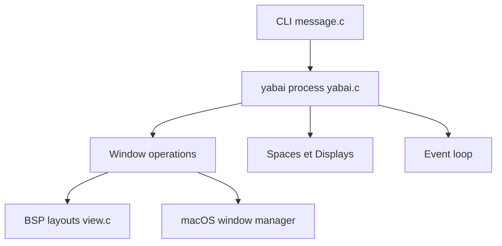

# asmvik/yabai

> Tiling window manager for macOS, driven from the command line, for advanced users.

## The problem
macOS has no automatic tiling window placement.

## What it actually does
Extends the macOS window manager: arrangement by binary space partitioning (BSP), per-application rules, focus that follows the mouse, disabling of desktop animations, creation of more than 16 spaces. It is controlled via CLI and via shortcuts with skhd. Some features require partially disabling SIP protection.

## How it is wired



## Trying it
Installation is described in the wiki, not in the README. The only command present:
```bash
defaults write com.apple.finder CreateDesktop -bool true
```

## Cost and gotchas
Free. Requires Accessibility permissions (and Screen Recording for animations). Disabling SIP exposes the machine: the author does not recommend it and disclaims all responsibility. The binary must be signed when you compile.

## What it is not
Not portable outside macOS. Not a turnkey productivity tool: everything is configured by hand. Native tabs (Terminal, Finder) misbehave.

## Alternatives
- skhd: keyboard shortcut daemon by the same author, to drive yabai.

## For you
To ignore unless you work on macOS and want window tiling: the gain is comfort, with no impact on data projects.
