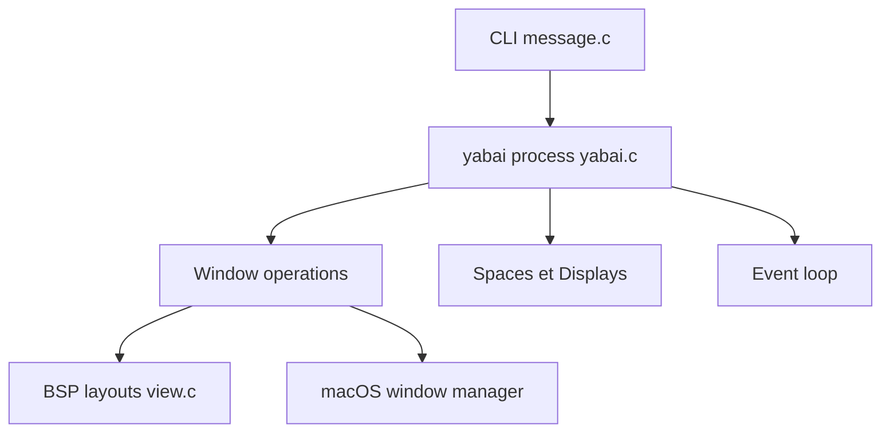

# asmvik/yabai

> Gestionnaire de fenêtres en mosaïque pour macOS, piloté en ligne de commande, pour utilisateurs avancés.

## Le problème
macOS ne dispose pas de placement automatique des fenêtres en mosaïque.

## Ce que ça fait vraiment
Complète le gestionnaire de fenêtres de macOS : arrangement par partition binaire de l'espace (BSP), règles par application, focus qui suit la souris, désactivation des animations de bureau, création de plus de 16 espaces. On le commande par CLI et par raccourcis via skhd. Certaines fonctions exigent de désactiver en partie la protection SIP.

## Comment c'est branché



## Essayer
Les installations sont décrites dans le wiki, pas dans le README. Seule commande présente :
```bash
defaults write com.apple.finder CreateDesktop -bool true
```

## Coût et pièges
Gratuit. Demande les permissions Accessibilité (et Enregistrement d'écran pour les animations). Désactiver SIP expose la machine : l'auteur ne le recommande pas et décline toute responsabilité. Le binaire doit être signé quand on compile.

## Ce que ce n'est pas
Ce n'est pas portable hors macOS. Ce n'est pas un outil de productivité clé en main : tout se configure à la main. Les onglets natifs (Terminal, Finder) se comportent mal.

## Alternatives
- skhd : démon de raccourcis clavier du même auteur, pour piloter yabai.

## Pour toi
À ignorer sauf si tu travailles sous macOS et veux une mosaïque de fenêtres : le gain est de confort, sans incidence sur les projets data.

