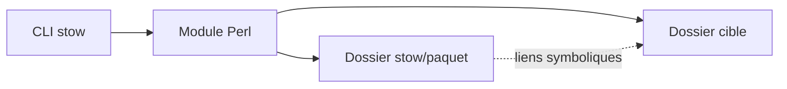

# aspiers/stow

> Dotfiles manager based on a tree of symbolic links, in Perl, for Unix users.

## The problem
Keeping your configuration files versioned in separate folders while making them appear in `~`.

## What it actually does
Mirrors a package folder into a target folder through symbolic links; stores no state between runs and never deletes files from the Stow folder. Originally designed for software compiled into `/usr/local/stow`. Perl: a CLI script plus a module.

## How it is wired


## Trying it
```bash
stow --help
man stow
```

## Cost and gotchas
Free. Installation described in `INSTALL.md` (not read here). Personal repository (fork), last push in December 2025.

## What it is not
Not a package manager: it resolves neither dependencies nor versions.

## Alternatives
No alternative named in the README (rpm, dpkg, Nix, Guix are cited as modern managers).

## For you
Keep an eye on it: simple and stateless for versioning your workstation dotfiles, unrelated to data.
