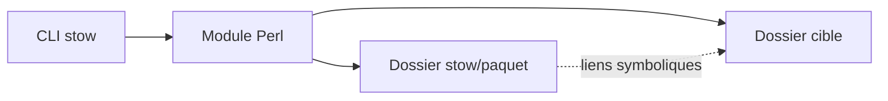

# aspiers/stow

> Gestionnaire de dotfiles par arbre de liens symboliques, en Perl, pour utilisateurs Unix.

## Le problème
Garder ses fichiers de configuration versionnés dans des dossiers séparés tout en les faisant apparaître dans `~`.

## Ce que ça fait vraiment
Reflète un dossier de paquet dans un dossier cible par liens symboliques ; ne stocke aucun état entre exécutions et ne supprime jamais de fichiers du dossier Stow. Initialement conçu pour des logiciels compilés dans `/usr/local/stow`. Perl : script CLI plus module.

## Comment c'est branché


## Essayer
```bash
stow --help
man stow
```

## Coût et pièges
Gratuit. Installation décrite dans `INSTALL.md` (non lu ici). Dépôt personnel (fork), dernier push en décembre 2025.

## Ce que ce n'est pas
Pas un gestionnaire de paquets : il ne résout ni dépendances ni versions.

## Alternatives
Aucune alternative nommée dans le README (rpm, dpkg, Nix, Guix sont cités comme gestionnaires modernes).

## Pour toi
À surveiller : simple et sans état pour versionner tes dotfiles de poste de travail, sans lien avec la donnée.

