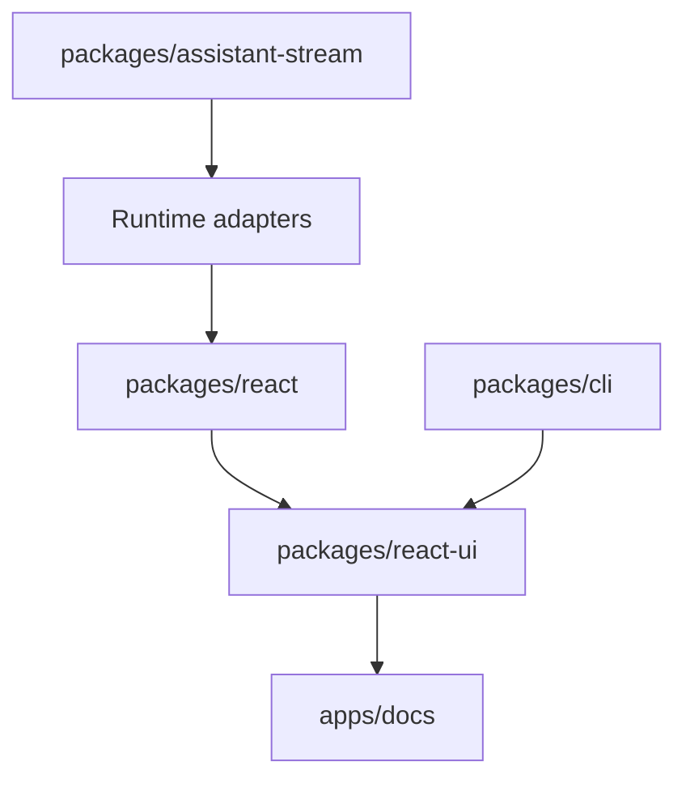

# assistant-ui/assistant-ui

> React/TypeScript component library for building AI chat interfaces, aimed at front-end developers.

## The problem
Building a decent AI chat (streaming, scrolling, attachments, markdown, accessibility) takes weeks of interface work.

## What it actually does
Provides composable primitives (`Thread`, `Message`, `Composer`, `ThreadList`, `ActionBar`) and a shadcn/ui theme copied into your project by the CLI. Runtimes connect the chat to the Vercel AI SDK, LangGraph, AG-UI, A2A or a data-stream backend. Generative UI for tool calls and human approvals. `assistant-cloud` handles history and storage.

## How it is wired


## Trying it
```bash
npx assistant-ui@latest create
npx assistant-ui@latest init
npm install @assistant-ui/react @assistant-ui/ai-sdk ai
```

## Cost and gotchas
The library is free; the language model it calls is at your expense (provider API key). `assistant-cloud` is a separate managed service.

## What it is not
Not a backend or a model: only the interface. React only.

## Alternatives
No alternative named in the README.

## For you
Adopt it if you need to give an agent or a model a chat interface: it plugs directly into LangGraph and the Vercel AI SDK and saves front-end work.
