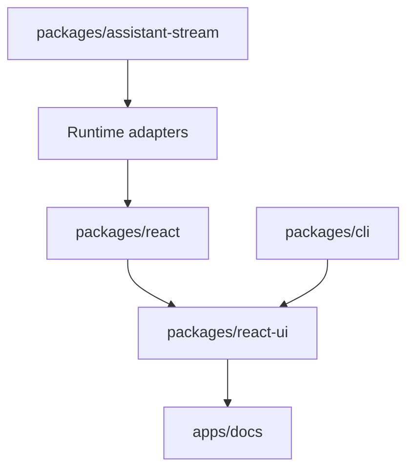

# assistant-ui/assistant-ui

> Bibliothèque React/TypeScript de composants pour construire des interfaces de chat IA, pour développeurs front.

## Le problème
Construire un chat IA correct (streaming, défilement, pièces jointes, markdown, accessibilité) demande des semaines de travail sur l'interface.

## Ce que ça fait vraiment
Fournit des primitives composables (`Thread`, `Message`, `Composer`, `ThreadList`, `ActionBar`) et un thème shadcn/ui copié dans ton projet par la CLI. Des runtimes connectent le chat au Vercel AI SDK, LangGraph, AG-UI, A2A ou un backend de flux de données. Interface générative pour les appels d'outils et approbations humaines. `assistant-cloud` gère historique et stockage.

## Comment c'est branché


## Essayer
```bash
npx assistant-ui@latest create
npx assistant-ui@latest init
npm install @assistant-ui/react @assistant-ui/ai-sdk ai
```

## Coût et pièges
La bibliothèque est gratuite ; le modèle de langage appelé reste à ta charge (clé d'API du fournisseur). `assistant-cloud` est un service géré séparé.

## Ce que ce n'est pas
Pas un backend ni un modèle : uniquement l'interface. Réservé à React.

## Alternatives
Aucune alternative nommée dans le README.

## Pour toi
À adopter si tu dois donner une interface de chat à un agent ou à un modèle : elle branche directement LangGraph et le Vercel AI SDK et économise le travail front.

