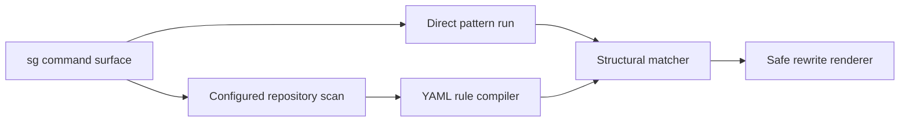

# ast-grep/ast-grep

> Pattern-based code search, lint and rewrite on the syntax tree, from the command line.

## The problem
`grep` and regexes miss the structure of code; mass text-based migrations break the code.

## What it actually does
Parses code with tree-sitter, matches patterns written like code (`$A` wildcard), and rewrites the matches. YAML rules for custom linters, parallel scan, JSON output, an LSP server, and Node, Python and WebAssembly bindings.

## How it is wired


## Trying it
```bash
npm install --global @ast-grep/cli
pip install ast-grep-cli
brew install ast-grep
ast-grep -p '$A && $A()' -l ts -r '$A?.()'
```

## Cost and gotchas
Free. A mass rewrite modifies files: check before applying.

## What it is not
Not a full semantic analysis: it works on syntax, not on types.

## Alternatives
No alternative named in the README; it compares itself to `grep`.

## For you
Adopt: the tool is useful for migrating Python or TypeScript code in batches, and for writing custom lint rules for your repos.
