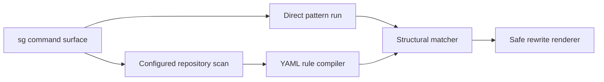

# ast-grep/ast-grep

> Recherche, lint et réécriture de code par motifs sur l'arbre syntaxique, en ligne de commande.

## Le problème
`grep` et les regex ratent la structure du code ; les migrations de masse par texte cassent le code.

## Ce que ça fait vraiment
Analyse le code avec tree-sitter, fait correspondre des motifs écrits comme du code (`$A` joker), et réécrit les correspondances. Règles YAML pour des linters maison, scan parallèle, sortie JSON, serveur LSP, liaisons Node, Python, WebAssembly.

## Comment c'est branché


## Essayer
```bash
npm install --global @ast-grep/cli
pip install ast-grep-cli
brew install ast-grep
ast-grep -p '$A && $A()' -l ts -r '$A?.()'
```

## Coût et pièges
Gratuit. Une réécriture de masse modifie les fichiers : vérifier avant d'appliquer.

## Ce que ce n'est pas
Pas une analyse sémantique complète : il travaille sur la syntaxe, pas sur les types.

## Alternatives
Aucune alternative nommée dans le README ; il se compare à `grep`.

## Pour toi
À adopter : l'outil sert à migrer du code Python ou TypeScript par lots, et à écrire des règles de lint maison pour tes dépôts.

