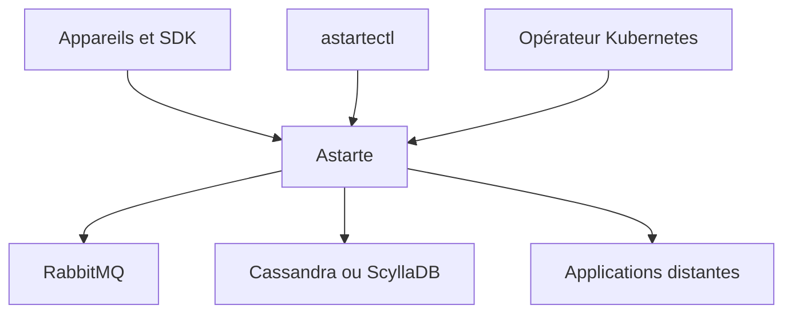

# astarte-platform/astarte

> Elixir IoT platform for connecting a fleet of devices to applications and processing their data.

## The problem
Connecting devices to remote applications requires modeling the data, handling real-time events and reducing the data streams.

## What it actually does
All-in-one solution: data modeling, automatic reduction, real-time events. It relies on RabbitMQ and Cassandra or ScyllaDB, and is deployed through a Kubernetes operator. SDKs exist for Python, Qt5, ESP32 and Elixir, along with the astartectl tool.

## How it is wired
Simplified diagram based on the sheet, no diagram provided.


## Trying it
```sh
git clone https://github.com/astarte-platform/astarte.git -b v1.4.0-rc.6 && cd astarte
docker run -v $(pwd)/compose:/compose astarte/docker-compose-initializer:1.4.0-rc.6
docker compose pull
docker compose up -d
```

## Cost and gotchas
Free, with 4 GB of free RAM and Docker. The docker-compose uses ScyllaDB under the BSL license: production use above the threshold requires a commercial license. No license is declared in the catalog.

## What it is not
Not a production-ready tool without study: the README asks you to read the architecture and the administration manual first. No hosted instance for now.

## Alternatives
No alternative named in the README.

## For you
Worth watching: relevant if you ingest sensor streams for models, but heavy and with no clear license.
