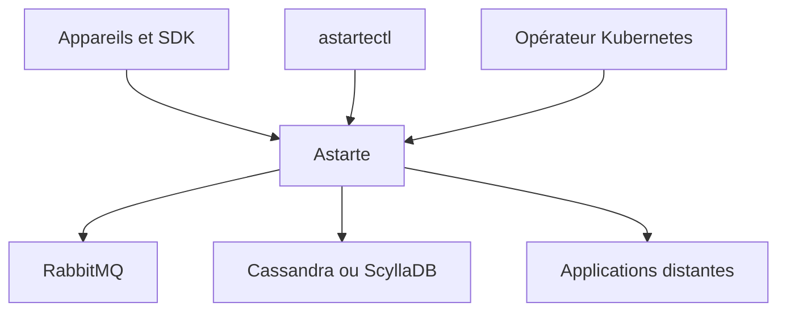

# astarte-platform/astarte

> Plateforme IoT en Elixir pour connecter une flotte d'appareils à des applications et traiter leurs données.

## Le problème
Relier des appareils à des applications distantes demande de modéliser les données, gérer les événements temps réel et réduire les flux.

## Ce que ça fait vraiment
Solution tout-en-un : modélisation des données, réduction automatique, événements en temps réel. Elle s'appuie sur RabbitMQ et Cassandra ou ScyllaDB, et se déploie via un opérateur Kubernetes. Des SDK existent pour Python, Qt5, ESP32 et Elixir, avec l'outil astartectl.

## Comment c'est branché
Schéma simplifié d'après la fiche, sans diagramme fourni.


## Essayer
```sh
git clone https://github.com/astarte-platform/astarte.git -b v1.4.0-rc.6 && cd astarte
docker run -v $(pwd)/compose:/compose astarte/docker-compose-initializer:1.4.0-rc.6
docker compose pull
docker compose up -d
```

## Coût et pièges
Gratuit, avec 4 Go de RAM libres et Docker. Le docker-compose utilise ScyllaDB sous licence BSL : usage de production au-dessus du seuil soumis à licence commerciale. Aucune licence n'est déclarée dans le catalogue.

## Ce que ce n'est pas
Pas un outil prêt pour la production sans étude : le README demande de lire l'architecture et le manuel d'administration avant. Pas d'instance hébergée pour l'instant.

## Alternatives
Aucune alternative nommée dans le README.

## Pour toi
À surveiller : pertinent si tu ingères des flux de capteurs pour des modèles, mais lourd et sans licence claire.

