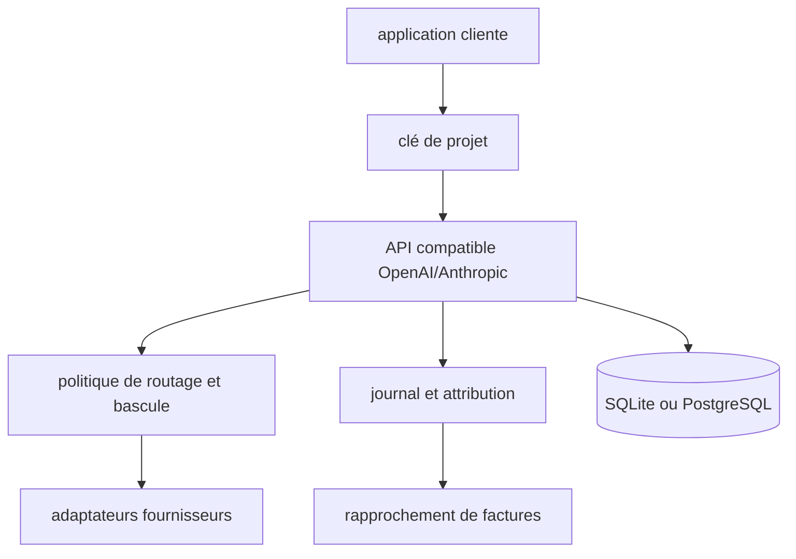

# astaxie/TokenHub

> Governance gateway that puts routing, quotas and cost attribution in front of every model call.

## The problem
As soon as several teams consume models, provider keys get copied into every application.
Nobody can then tie a bill to a project, or switch models without changing client code.

## What it actually does
Issues keys scoped per project and per team, with quotas, member permissions and concurrency limits.
Model routing is an administrable policy: priority, weights, failover order, per-scenario choice, route health diagnostics.
Logs every request, attributing it to a user, a project, a team, a model and a cost centre, then compares internal usage to provider invoices.
Exposes OpenAI-compatible APIs (`/v1/chat/completions`, `/v1/responses`, `/v1/embeddings`) and Anthropic APIs (`/v1/messages`, `/v1/messages/count_tokens`), plus image generation and editing.

## How it is wired


## Trying it
```bash
curl -fsSL https://raw.githubusercontent.com/astaxie/TokenHub/main/deploy/native/install.sh \
  -o /tmp/tokenhub-install.sh
sudo bash /tmp/tokenhub-install.sh install
cp deploy/.env.example deploy/.env
./deploy/install.sh
```

## Cost and gotchas
Every `change-me` value in `deploy/.env` must be replaced with a strong secret before starting.
The initial admin password is printed only once by the native installer, or equals `TOKENHUB_BOOTSTRAP_ADMIN_PASSWORD` under Docker.
Upstream provider keys remain on you; SQLite by default, PostgreSQL required for multi-instance.

## What it is not
Not just another gateway that merely redirects to several providers: the README explicitly states governance as the difference.
Not a managed service: everything is self-hosted, including backup and upgrades.
The 150+ provider models are not all native — without a dedicated adapter, the connection goes through OpenAI-compatible mode, with the limits that implies.

## Alternatives
No alternative named in the README.

## For you
Worth a look the day several projects draw on the same API keys and the bill stops being explainable.
