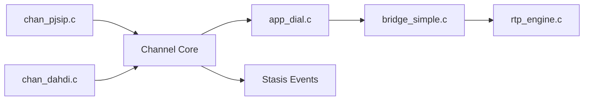

# asterisk/asterisk

> Open source PBX server and telephony toolkit, for telecom administrators and VoIP integrators.

## The problem
Linking SIP telephony, traditional lines and applications (queues, voicemail, conferences) requires a common software core.

## What it actually does
A call enters through a channel driver (PJSIP or DAHDI), becomes an internal channel, runs dialplan applications and is bridged over RTP media or hardware. Provides queues, conferences, voicemail and parking, with Stasis events, CDR/CEL and the Manager API.

## How it is wired


## Trying it
```bash
./configure
make menuselect
make
make install
make samples
asterisk -vvvc
```

## Cost and gotchas
C compilation with many dependencies (`contrib/scripts/install_prereq`). `make samples` overwrites the existing configuration. Read the security document before exposing it.

## What it is not
Not a turnkey application: it is an engine configured through files. Sensitive to clock jumps (NTP mandatory).

## Alternatives
- None cited in the README.

## For you
Ignore on the data/AI side: relevant only for a live voice project that would need a telephony platform.
