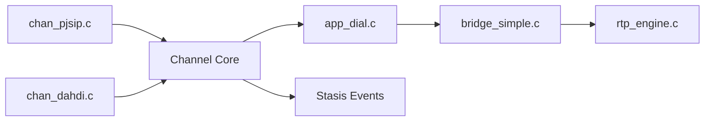

# asterisk/asterisk

> Serveur PBX open source et boîte à outils de téléphonie, pour administrateurs télécoms et intégrateurs VoIP.

## Le problème
Relier téléphonie SIP, lignes traditionnelles et applications (files d'attente, messagerie vocale, conférences) demande un cœur logiciel commun.

## Ce que ça fait vraiment
Un appel entre par un pilote de canal (PJSIP ou DAHDI), devient un canal interne, exécute des applications de dialplan et est relié en média RTP ou matériel. Fournit files d'attente, conférences, messagerie vocale et parcage, avec événements Stasis, CDR/CEL et API Manager.

## Comment c'est branché


## Essayer
```bash
./configure
make menuselect
make
make install
make samples
asterisk -vvvc
```

## Coût et pièges
Compilation C avec nombreuses dépendances (`contrib/scripts/install_prereq`). `make samples` écrase la configuration existante. Lire le document de sécurité avant de l'exposer.

## Ce que ce n'est pas
Pas une application clé en main : c'est un moteur qui se configure par fichiers. Sensible aux sauts d'horloge (NTP obligatoire).

## Alternatives
- Aucune citée dans le README.

## Pour toi
À ignorer côté data/IA : pertinent seulement pour un projet de voix en direct où il faudrait une plateforme de téléphonie.

