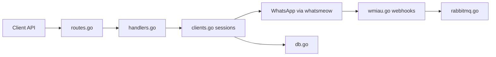

# asternic/wuzapi

> Multi-account REST API in Go that drives WhatsApp through the whatsmeow library.

## The problem
Automating sending and receiving WhatsApp messages without an Android emulator or headless Chrome.

## What it actually does
HTTP server that manages several WhatsApp sessions (QR code) and exposes endpoints: session, messages (text, media, polls), users, groups, presence. Events go out through HMAC-signed webhooks or RabbitMQ; storage is SQLite or PostgreSQL, with optional S3 for media. Built-in dashboard.

## How it is wired


## Trying it
```bash
cp .env.sample .env
go build .
./wuzapi -logtype=console -color=true
brew install asternic/wuzapi/wuzapi
```

## Cost and gotchas
Violating WhatsApp's terms can get the number banned. If the admin and encryption keys are auto-generated, you must back them up. A change in the WhatsApp protocol can break the connection.

## What it is not
Not the official WhatsApp Business API; not affiliated with WhatsApp.

## Alternatives
The WhatsApp Business API through an official provider, recommended by the README for commercial use.

## For you
Worth watching: useful for pipeline notifications or a prototype chatbot, but fragile and risky in production.
