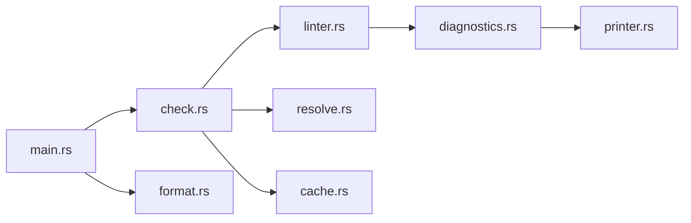

# astral-sh/ruff

> A Python linter and formatter written in Rust that replaces Flake8, Black and isort in a single tool.

## The problem
Chaining Flake8 and its plugins, Black and isort slows down CI and multiplies configurations.

## What it actually does
`ruff check` runs more than 900 rules (native rewrites of Flake8 plugins, isort, pyupgrade…) with automatic fixes; `ruff format` applies a Black-compatible style. Built-in cache, cascading configuration for monorepos, editor server (VS Code), pre-commit hook, GitHub Action.

## How it is wired


## Trying it
```bash
uv tool install ruff@latest
ruff check
ruff format
```

## Cost and gotchas
Free. The `--preview` mode enables unstable features. The "10-100x" gains are the README's claim, not reproduced here.

## What it is not
Not a type checker (Astral offers `ty` separately). Parity with Black is the goal, not guaranteed on every case.

## Alternatives
Flake8, Black, isort: the tools it replaces, cited in the README.

## For you
Adopt: a single fast tool to lint and format your Python data/ML projects, already used by pandas, FastAPI and Hugging Face according to the README.
