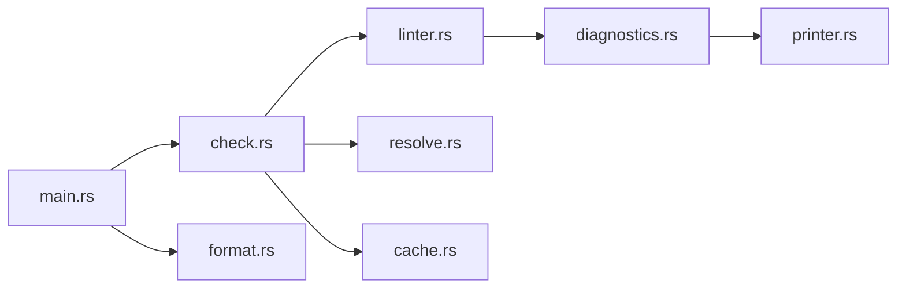

# astral-sh/ruff

> Linter et formateur Python écrit en Rust qui remplace Flake8, Black et isort en un seul outil.

## Le problème
Enchaîner Flake8 et ses plugins, Black et isort ralentit la CI et multiplie les configurations.

## Ce que ça fait vraiment
`ruff check` lance plus de 900 règles (réécritures natives de plugins Flake8, isort, pyupgrade…) avec corrections automatiques ; `ruff format` applique un style compatible Black. Cache intégré, configuration en cascade pour monorepos, serveur d'éditeur (VS Code), hook pre-commit, GitHub Action.

## Comment c'est branché


## Essayer
```bash
uv tool install ruff@latest
ruff check
ruff format
```

## Coût et pièges
Gratuit. Le mode `--preview` active des fonctions instables. Les gains « 10-100x » sont l'affirmation du README, non reproduits ici.

## Ce que ce n'est pas
Pas un vérificateur de types (Astral propose `ty` à part). Parité avec Black visée, pas garantie sur chaque cas.

## Alternatives
Flake8, Black, isort : les outils remplacés, cités dans le README.

## Pour toi
À adopter : un seul outil rapide pour linter et formater tes projets Python data/ML, déjà utilisé par pandas, FastAPI et Hugging Face selon le README.

