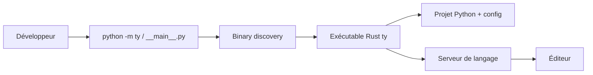

# astral-sh/ty

> Python type checker and language server written in Rust, by Astral, for Python developers.

## The problem
mypy and Pyright are slow on large projects, especially in the editor where every keystroke triggers a new analysis.

## What it actually does
`ty check` analyzes a project and returns diagnostics with context; a language server mode provides navigation, completion, actions, auto-imports and hover information, with fine-grained incremental analysis. It claims 10 to 100 times the speed of mypy and Pyright, and supports intersection types and advanced narrowing. The Python module `python -m ty` only finds and launches the Rust binary; the Rust sources are in a submodule not read here.

## How it is wired


## Trying it
```bash
uvx ty check
```

## Cost and gotchas
Free. Versioning is 0.0.x: breaking changes are possible, including on diagnostics, between two versions.

## What it is not
It is not stable yet: the README says "beta". It is not a formatter nor a linter.

## Alternatives
mypy and Pyright (speed comparison cited in the README).

## For you
Worth watching: very promising for large ML codebases, but wait for stability before enforcing it in CI.
