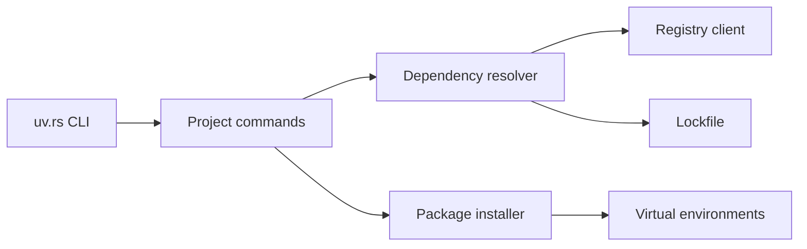

# astral-sh/uv

> Python package and project manager written in Rust, to replace pip, poetry and pyenv.

## The problem
A Python project mixes pip, virtualenv, pyenv and poetry, with slow and poorly reproducible resolution.

## What it actually does
A single tool: projects with a universal lockfile and workspaces, scripts with inline metadata, tools (`uvx`), Python version installation, a pip-compatible interface, build and publish. A global cache deduplicates dependencies. The README claims a 10 to 100 times speedup over pip.

## How it is wired


## Trying it
```bash
curl -LsSf https://astral.sh/uv/install.sh | sh
uv init example
uv add ruff
uv run ruff check
uvx pycowsay 'hello world!'
uv python install 3.12 3.13 3.14
```

## Cost and gotchas
Free. The speed factor is claimed by the publisher. Backed by Astral, a commercial company.

## What it is not
Not a conda environment manager: no non-Python packages. Not a pipeline orchestrator.

## Alternatives
The README cites pip, pip-tools, pipx, poetry, pyenv, twine and virtualenv as replaced tools.

## For you
Adopt: reproducible environments and fast installs for your data and ML projects, with a versionable lockfile.
